<p align="center">
  
</p>

<p align="center">
  <a href="https://github.com/ishandutta2007/Awesome-Awesome-Awesome"></a>
  <a href="https://discord.gg/jc4xtF58Ve"></a>
  <a href="https://github.com/ishandutta2007/Awesome-Error-Tracking-APM/stargazers"></a>
  <a href="https://github.com/ishandutta2007/Awesome-Error-Tracking-APM/network/members"></a>
  <a href="https://github.com/ishandutta2007/Awesome-Error-Tracking-APM/blob/main/LICENSE"></a>
  <a href="https://github.com/ishandutta2007/Awesome-Awesome-Awesome"></a>
  <a href="https://opentelemetry.io/"></a>
  <a href="https://github.com/ishandutta2007/Awesome-Error-Tracking-APM/pulls"></a>
  <a href="https://github.com/ishandutta2007"></a>
</p>

---

# ⚡ Awesome Error Tracking & APM Ecosystem 🔍

> **A curated, battle-tested directory of top SaaS platforms and open-source projects for Application Performance Monitoring (APM), Real-Time Error Tracking, Exception Reporting, Distributed Tracing, and Production Observability.**

Modern distributed systems, cloud microservices, and client-heavy single-page applications cannot rely on reactive, log-grepping incident response. This repository indexes the finest commercial SaaS suites and self-hosted open-source software built to track errors, surface latency bottlenecks, capture stack traces, and deliver end-to-end system visibility.

---

## 📑 Table of Contents

- [🌐 Sector Overview & Market Dynamics](#-sector-overview--market-dynamics)
- [🏢 SaaS & Hosted APM / Error Tracking Platforms](#-saas--hosted-apm--error-tracking-platforms)
- [🚀 Top Open-Source Projects (Ranked by GitHub Stars)](#-top-open-source-projects-ranked-by-github-stars)
- [🧭 Decision Matrix: SaaS vs. Self-Hosted](#-decision-matrix-saas-vs-self-hosted)
- [🛠️ Recommended Architecture Blueprints](#️-recommended-architecture-blueprints)
- [🤝 Contributing Guidelines](#-contributing-guidelines)
- [💖 Support & Community](#-support--community)
- [⭐ Star History](#star-history)
- [⚖️ Disclaimer & Licensing](#️-disclaimer--licensing)

---

## 🌐 Sector Overview & Market Dynamics

* **📈 Estimated Market Size:**  
  The global **Application Performance Monitoring (APM) & Error Tracking / Observability** market is valued at approximately **$10.5 billion to $12.0 billion** and is projected to surpass **$23.5 billion by 2030**, expanding at a compound annual growth rate (**CAGR of ~13.5%**).
* **🔄 Industry Fragmentation vs. Concentration:**  
  The industry represents a **moderately fragmented sector transitioning into platform concentration**. Enterprise buyers increasingly consolidate around "winner-take-most" full-stack observability suites (Datadog, Dynatrace, New Relic, Cisco AppDynamics) to minimize tool sprawl and vendor overhead. However, deep category specialists (such as Sentry for developer-first error triage and LogRocket for frontend session replay) alongside a rapidly surging, **OpenTelemetry-native open-source ecosystem** (Prometheus, SigNoz, Jaeger, OpenObserve, HyperDX) maintain healthy decentralization, protecting engineering organizations against proprietary lock-in and steep cloud egress billing.

---

## 🏢 SaaS & Hosted APM / Error Tracking Platforms

The table below lists the premier commercial SaaS solutions for error monitoring and application performance management, **sorted descending by company size (valuation / annual revenue)**.

| 🏢 Platform / Provider | 📈 Company Scale (Valuation / Revenue) | 💵 Starting Pricing | 🎁 Free Tier / Free Trial Limits | 🎯 Core Focus & Capabilities |
| :--- | :--- | :--- | :--- | :--- |
| **[AppDynamics](https://www.appdynamics.com/)** *(Cisco Systems)* | **~$210B Market Cap**<br>*(Parent: Cisco; ~$54B Rev; Acquired for $3.7B)* | **$6 / vCPU / mo** *(Infra)*<br>**$33 / host / mo** *(Premium APM)* | **15-day free trial** with full platform capabilities; no credit card required; no permanent free tier. | 🏛️ Enterprise APM, transaction mapping, business performance correlation, and hybrid cloud/SAP monitoring. |
| **[Datadog](https://www.datadoghq.com/)** | **~$42B Market Cap**<br>*(NASDAQ: DDOG; ~$2.7B+ Rev)* | **$31 / host / mo** *(Standard APM, billed annually)* or **$36 / host / mo** *(monthly)* | **14-day free trial** with complete APM & tracing access. Permanent free tier is limited to 5 infrastructure hosts with 1-day retention and **0 APM spans**. | 📊 Unified observability, distributed tracing, Continuous Profiler, synthetic monitoring, RUM, and logs. |
| **[Dynatrace](https://www.dynatrace.com/)** | **~$16B Market Cap**<br>*(NYSE: DT; ~$1.5B+ Rev)* | **$0.01 / memory-GiB / hr**<br>*(~$58 / mo for 8 GiB host)* or **$0.04 / host / hr** *(Infra)* | **15-day free trial** with complete automated discovery & Davis AI analysis; no perpetual free tier. | 🤖 AI-driven full-stack observability (Davis AI engine), automatic dependency mapping, and microservice tracing. |
| **[New Relic](https://newrelic.com/)** | **$6.5B Valuation**<br>*(Acquired by Francisco Partners & TPG; ~$1.0B+ Rev)* | **$0.40 / GB** beyond 100 GB + **$99 / user / mo** per additional Full Platform seat *(Standard tier)* | **100 GB / month free forever** across all telemetry, 1 Full Platform user, unlimited basic users, and 8-day retention. | 📡 All-in-one telemetry data platform, 50+ integrations, distributed tracing, and real user browser monitoring. |
| **[Sentry](https://sentry.io/)** | **~$3.0B+ Valuation**<br>*(Private, Series E; ~$150M+ ARR)* | **$26 / mo** *(Team plan, billed annually)* or **$29 / mo** *(monthly)* | **Developer Plan Free Forever:** 5,000 error events/mo, 10,000 performance units, 50 session replays, 1 user, 30-day retention. | 🐞 Category-defining error tracking, code-level diagnostics, stack traces, breadcrumbs, and Session Replay. |
| **[Bugsnag](https://www.bugsnag.com/)** *(SmartBear)* | **~$2.2B Valuation**<br>*(SmartBear / Francisco Partners; ~$250M+ Rev)* | **$20 / mo** *(Select plan for small teams)* | **Free Plan Forever:** 7,500 error events/mo, 1 million spans/mo, 1 user, 7-day retention; or **14-day Enterprise trial**. | 📱 Application stability score index, mobile crash reporting (iOS/Android/React Native), and release health. |
| **[LogRocket](https://logrocket.com/)** | **~$350M Valuation**<br>*(Private, Series C; ~$35M+ ARR)* | **$69 / mo** *(Core plan, billed annually for up to 10k sessions/mo)* | **14-day free trial** with full session replay & error analytics. *(Perpetual free tier has been discontinued).* | 🎥 Pixel-perfect user session replay, frontend JavaScript error monitoring, DOM mutations, and network waterfall logs. |
| **[Rollbar](https://rollbar.com/)** | **~$120M Valuation**<br>*(Private; ~$50M funding; ~$18M ARR)* | **$12.50 / mo** *(Essentials plan, billed annually for 25k events)* or **$29 / mo** *(monthly)* | **Free Plan Forever:** 5,000 error events/mo, 1,000 session replays/mo, unlimited users, and 30-day retention. | ⚡ Real-time error intelligence, AI-assisted grouping, deployment tracking, and automatic issue categorization. |
| **[Raygun](https://raygun.com/)** | **~$50M Valuation**<br>*(Private bootstrapped/growth; ~$12M ARR)* | **$40 / mo** *(Crash Reporting, 100k events)* or **$80 / mo** *(APM, 100k traces)* | **14-day free trial** with unlimited event volume and full APM/RUM access; no credit card required; no perpetual free tier. | 💻 Developer-first crash reporting, Real User Monitoring (RUM), and deep server-side execution profiling. |
| **[TrackJS](https://trackjs.com/)** | **~$20M Valuation**<br>*(Private bootstrapped; ~$4M ARR)* | **$49 / mo** *(Starter plan: 100,000 page views/mo, ~800,000 error capacity)* | **14-day free trial** with full feature access; no credit card required; no perpetual free tier. | 🌐 Client-side JavaScript exception monitoring, browser environment recording, and script noise suppression. |

---

## 🚀 Top Open-Source Projects (Ranked by GitHub Stars)

The following open-source solutions allow teams to host their own APM, distributed tracing, telemetry pipelines, and error tracking infrastructure. **Ranked in descending order by GitHub star count**:

### 1. [Prometheus](https://github.com/prometheus/prometheus) [](https://github.com/prometheus/prometheus/stargazers)
* **Description:** The CNCF-graduated open-source systems monitoring and alerting toolkit. Serves as the de facto standard metric collection engine and time-series database across modern cloud-native Kubernetes environments.
* **Tech Stack:** Go, PromQL, TSDB.
* **Best For:** Infrastructure and service-level metric monitoring, SLO/SLA tracking, and multi-dimensional alerts.

### 2. [Sentry Self-Hosted](https://github.com/getsentry/sentry) [](https://github.com/getsentry/sentry/stargazers)
* **Description:** The official open-source, source-available (FSL) engine powering Sentry. Features complete parity with Sentry SaaS: code-level stack traces, performance monitoring, issue grouping, and alert routing.
* **Tech Stack:** Python, ClickHouse, Snuba, Apache Kafka, Redis, PostgreSQL.
* **Best For:** Dedicated platform/SRE teams requiring comprehensive Sentry error triage on internal air-gapped infrastructure (requires 16GB+ RAM).

### 3. [SigNoz](https://github.com/SigNoz/signoz) [](https://github.com/SigNoz/signoz/stargazers)
* **Description:** OpenTelemetry-native full-stack APM. Unifies distributed traces, metrics, and application logs into an intuitive single pane of glass powered by ClickHouse columnar storage.
* **Tech Stack:** OpenTelemetry, ClickHouse, Go, React.
* **Best For:** Teams migrating from Datadog or New Relic who want turn-key APM and log management with zero retention caps on self-hosted instances.

### 4. [Grafana Loki](https://github.com/grafana/loki) [](https://github.com/grafana/loki/stargazers)
* **Description:** Horizontally scalable, highly available multi-tenant log aggregation system inspired by Prometheus. Indexes only metadata labels rather than full text, slashing storage and memory costs.
* **Tech Stack:** Go, LogQL, Object Storage (S3/GCS/MinIO).
* **Best For:** High-volume logging correlated seamlessly with Grafana dashboards, Prometheus metrics, and Tempo traces.

### 5. [Apache SkyWalking](https://github.com/apache/skywalking) [](https://github.com/apache/skywalking/stargazers)
* **Description:** Apache top-level observability analysis platform and service mesh telemetry tool designed for cloud-native, microservice architectures. Deep automatic bytecode instrumentation for Java, .NET, and Go.
* **Tech Stack:** Java, Elasticsearch / BanyanDB, OTLP.
* **Best For:** Large-scale enterprise service mesh (Istio/Envoy) deployments, microservice RPC tracing, and distributed APM.

### 6. [Jaeger](https://github.com/jaegertracing/jaeger) [](https://github.com/jaegertracing/jaeger/stargazers)
* **Description:** CNCF-graduated distributed tracing system originally developed by Uber. Jaeger v2 is natively rebuilt on top of the OpenTelemetry Collector framework for seamless OTLP trace ingestion.
* **Tech Stack:** Go, OpenTelemetry Collector, Elasticsearch / OpenSearch, Memory/Cassandra.
* **Best For:** High-throughput microservice request tracing, bottleneck isolation, and RPC latency analysis.

### 7. [Vector](https://github.com/vectordotdev/vector) [](https://github.com/vectordotdev/vector/stargazers)
* **Description:** High-performance, ultra-low-footprint observability data pipeline written in Rust. Capable of receiving, transforming, filtering, and routing massive streams of logs, metrics, and trace events.
* **Tech Stack:** Rust, VRL (Vector Remap Language).
* **Best For:** Telemetry aggregation proxies, PII data scrubbing, log transformation, and multi-destination routing.

### 8. [OpenObserve](https://github.com/openobserve/openobserve) [](https://github.com/openobserve/openobserve/stargazers)
* **Description:** Cloud-native observability platform built in Rust for logs, metrics, and traces. Delivers up to 140x lower storage costs compared to Elasticsearch by storing data directly in object storage (S3/GCS).
* **Tech Stack:** Rust, Apache Arrow, DataFusion, Object Storage.
* **Best For:** Cost-conscious engineering teams needing an all-in-one alternative to Elasticsearch, Splunk, and Datadog.

### 9. [VictoriaMetrics](https://github.com/VictoriaMetrics/VictoriaMetrics) [](https://github.com/VictoriaMetrics/VictoriaMetrics/stargazers)
* **Description:** Blazing-fast, cost-effective, and scalable monitoring solution and time-series database. Serves as a drop-in long-term storage replacement for Prometheus with significantly lower RAM/CPU requirements.
* **Tech Stack:** Go, MetricsQL.
* **Best For:** Massive-scale Prometheus metrics storage, high ingestion rates, and multi-tenant telemetry backends.

### 10. [Pinpoint](https://github.com/pinpoint-apm/pinpoint) [](https://github.com/pinpoint-apm/pinpoint/stargazers)
* **Description:** APM tool for large-scale distributed systems, featuring byte-code instrumentation that traces transactions without requiring manual application code changes.
* **Tech Stack:** Java, HBase, Spring.
* **Best For:** High-throughput Java, PHP, and Python microservices where deep call-stack visualization is critical.

### 11. [Grafana Pyroscope](https://github.com/grafana/pyroscope) [](https://github.com/grafana/pyroscope/stargazers)
* **Description:** Continuous profiling platform that enables developers to monitor resource utilization (CPU, memory, lock contention) down to the specific line of source code with interactive flame graphs.
* **Tech Stack:** Go, Rust, eBPF.
* **Best For:** Profiling CPU spikes, memory leaks, and optimizing runtime performance in live production applications.

### 12. [HyperDX](https://github.com/hyperdxio/hyperdx) [](https://github.com/hyperdxio/hyperdx/stargazers)
* **Description:** Developer-friendly observability platform natively engineered on ClickHouse. Seamlessly correlates frontend session replay, browser exceptions, backend traces, and system logs in one unified timeline.
* **Tech Stack:** TypeScript, ClickHouse, OpenTelemetry.
* **Best For:** Full-stack developers wanting to correlate user-facing browser errors directly with backend database spans.

### 13. [Highlight.io](https://github.com/highlight/highlight) [](https://github.com/highlight/highlight/stargazers)
* **Description:** Full-stack monitoring tool combining pixel-perfect session replay, error monitoring, server logs, and traces. Features an open-source hobby self-hosted deployment.
* **Tech Stack:** Go, ClickHouse, React, rrweb.
* **Best For:** Frontend-heavy web applications where reproducing edge-case bugs via session replay accelerates resolution.

### 14. [OpenTelemetry Collector](https://github.com/open-telemetry/opentelemetry-collector) [](https://github.com/open-telemetry/opentelemetry-collector/stargazers)
* **Description:** The vendor-neutral telemetry proxy and ingestion engine. Ingests, processes (batching, sampling, attribute redaction), and exports telemetry data across OTLP, Prometheus, Jaeger, and proprietary SaaS backends.
* **Tech Stack:** Go, OTLP (OpenTelemetry Protocol).
* **Best For:** Decoupling application instrumentation from backend monitoring vendors.

### 15. [Pixie](https://github.com/pixie-io/pixie) [](https://github.com/pixie-io/pixie/stargazers)
* **Description:** CNCF eBPF-powered observability platform for Kubernetes. Automatically captures network traffic, HTTP/gRPC requests, DNS queries, and CPU profiles with zero code changes or manual instrumentation.
* **Tech Stack:** C++, Go, eBPF, PxL.
* **Best For:** Instant, no-code Kubernetes microservice observability and real-time network traffic debugging.

### 16. [Grafana Tempo](https://github.com/grafana/tempo) [](https://github.com/grafana/tempo/stargazers)
* **Description:** High-volume, cost-efficient distributed tracing backend. Designed to store massive trace volumes directly in object storage (S3/GCS) without requiring complex index clusters.
* **Tech Stack:** Go, TraceQL, Object Storage.
* **Best For:** Teams already invested in the Grafana visualization and alerting ecosystem.

### 17. [Uptrace](https://github.com/uptrace/uptrace) [](https://github.com/uptrace/uptrace/stargazers)
* **Description:** OpenTelemetry-native APM designed for extreme operational efficiency. Processes billions of spans on a single ClickHouse node with built-in alerting and performance dashboards.
* **Tech Stack:** Go, ClickHouse, OpenTelemetry.
* **Best For:** Cost-conscious teams that require flat, predictable self-hosted APM infrastructure. *(Community edition has a 14-day retention limit).*

### 18. [Errbit](https://github.com/errbit/errbit) [](https://github.com/errbit/errbit/stargazers)
* **Description:** The classic open-source, Airbrake-compatible error tracking server. A lightweight exception collector that captures application stack traces without heavy dependencies.
* **Tech Stack:** Ruby, MongoDB.
* **Best For:** Legacy Rails/Ruby setups and simple microservices looking for a lightweight, no-frills self-hosted error catcher.

### 19. [Bugsink](https://github.com/bugsink/bugsink) [](https://github.com/bugsink/bugsink/stargazers)
* **Description:** Lightweight, self-hosted error tracker engineered as a drop-in destination for Sentry SDKs. Provides rich stack traces and local variable debugging with minimal resource footprint.
* **Tech Stack:** Python, Django, MySQL / SQLite.
* **Best For:** Small-to-mid engineering teams wanting Sentry SDK compatibility without running Sentry's heavy multi-service infrastructure.

### 20. [Elastic APM Server](https://github.com/elastic/apm-server) [](https://github.com/elastic/apm-server/stargazers)
* **Description:** Ingestion server for Elastic APM agents and OpenTelemetry traces, transforming APM data into Elasticsearch documents for rich Kibana visualization.
* **Tech Stack:** Go, Elasticsearch / Kibana.
* **Best For:** Organizations with large existing Elasticsearch and Kibana clusters.

### 21. [GlitchTip](https://gitlab.com/glitchtip/glitchtip-backend) [](https://gitlab.com/glitchtip/glitchtip-backend/-/starrers)
* **Description:** Open-source, Sentry-SDK-compatible error and uptime tracking platform. Simply change your DSN and your existing `@sentry/*` SDK code works immediately. Operates efficiently in **4 small containers on just 512MB RAM** (versus Sentry Self-Hosted's 16GB+ RAM requirement).
* **Tech Stack:** Python, Django, PostgreSQL, Celery, Redis.
* **Best For:** Teams seeking modern, lightweight, low-maintenance Sentry SDK compatibility.

---

## 🧭 Decision Matrix: SaaS vs. Self-Hosted

| Decision Factor | 🏢 SaaS Platforms (Datadog, Sentry, New Relic) | 🚀 Self-Hosted Stacks (SigNoz, Prometheus, Jaeger) |
| :--- | :--- | :--- |
| **Setup Speed** | ⚡ **Minutes** — Sign up, install SDK/agent, start debugging. | ⏳ **Hours to Days** — Requires Docker/Kubernetes helm charts and storage backends. |
| **Operational Overhead** | 🟢 **Zero** — Vendor manages storage, retention, updates, and scaling. | 🟡 **Moderate to High** — Your SRE team manages disk, DB scaling, ClickHouse, and upgrades. |
| **Data Privacy & Compliance** | 🟡 **Requires DPAs/BAAs** — Data leaves your VPC unless enterprise on-prem is purchased. | 🟢 **100% Data Sovereignty** — Telemetry never leaves your internal air-gapped infrastructure. |
| **Cost at Scale** | 🔴 **High / Unpredictable** — Bills scale with hosts, custom metrics, and ingested gigabytes. | 🟢 **Fixed / Predictable** — Cost is bounded by your underlying compute and disk/S3 storage. |
| **Customization** | 🟡 **Limited to Vendor API** | 🟢 **Complete Freedom** — Query raw ClickHouse SQL, modify collector pipelines, and build custom plugins. |

---

## 🛠️ Recommended Architecture Blueprints

### 1. The Modern Cloud-Native Standard (OpenTelemetry-First)
```
Application (OTel SDKs) ──> OpenTelemetry Collector ──┬──> Prometheus / VictoriaMetrics (Metrics)
                                                      ├──> Jaeger / Tempo (Traces)
                                                      └──> Loki / OpenObserve (Logs)
```
* **Why it works:** Total vendor neutrality. You can switch storage backends without touching application source code.

### 2. The Lightweight Sentry-Compatible Stack
```
Frontend & Backend (Sentry SDKs) ──> GlitchTip or Bugsink (512MB - 1GB RAM) ──> PostgreSQL
```
* **Why it works:** Leverage Sentry’s mature SDK ecosystem across 30+ languages without paying enterprise SaaS fees or running 20+ Kafka/Snuba containers.

### 3. The ClickHouse-Powered Full-Stack Observability Pipeline
```
Web/Mobile App (Session Replay + Errors) ──┐
Microservices (Traces + Metrics)        ──┴──> SigNoz or HyperDX ──> ClickHouse Cluster
```
* **Why it works:** High-throughput ingestion, instant SQL-based filtering, and unified correlation between frontend session recordings and backend database queries.

---

## 🤝 Contributing Guidelines

Contributions, corrections, and new tool recommendations are welcome!

1. 🍴 **Fork** this repository.
2. 🌿 Create a feature branch: `git checkout -b add-new-tool`.
3. 📝 Update `README.md`:
   - For SaaS tools: include vendor name, link, company size/valuation, exact starting price, exact free tier limits, and core focus.
   - For open-source tools: include GitHub repo link, star badge (`style=social&color=white`), tech stack, description, and place it in the correct star-count descending order.
4. 🚀 Submit a **Pull Request** with a concise description of your changes.

---

## 💖 Support & Community

Thank you so much for exploring and supporting the **Awesome Error Tracking & APM** ecosystem guide! Curating, updating, and researching these tools takes dedication and time.

If you found this list helpful:
- ⭐ **Star** this repository on GitHub to show your appreciation and boost its visibility!
- 🍴 **Fork** the repo and contribute additions or updates.
- 📢 **Share** this guide with teammates, DevOps peers, and developer communities.
- ☕ **Buy a Coffee / Sponsor**: If you'd like to support ongoing development and maintenance, visit the [GitHub Sponsors Dashboard](https://github.com/sponsors/ishandutta2007). Your generosity makes a huge difference!

<p align="center">
  <a href="https://github.com/sponsors/ishandutta2007">
    
  </a>
</p>

---

##  Star History
[](https://star-history.dera.page/#ishandutta2007/Awesome-Error-Tracking-APM&type=date&legend=top-left)

---

## ⚖️ Disclaimer & Licensing

* This repository is a community-curated list and does not constitute an official endorsement of any commercial product.
* All product names, logos, and brands are property of their respective owners.
* Licensed under the [MIT License](LICENSE).
